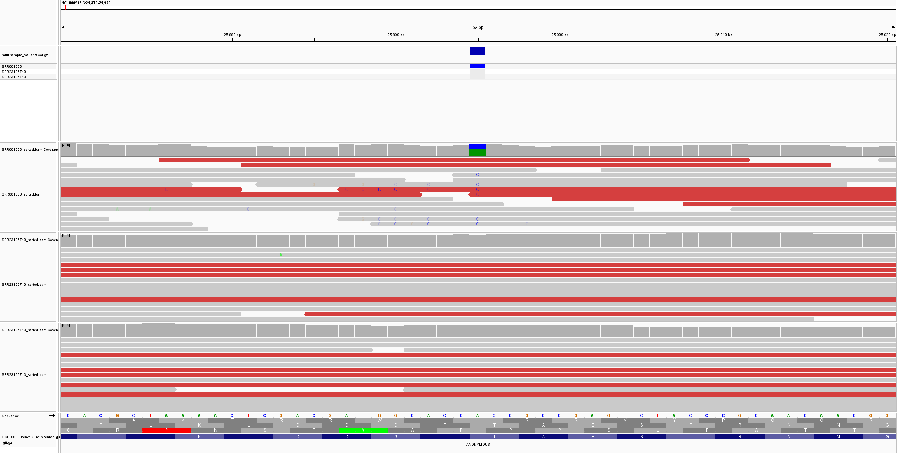
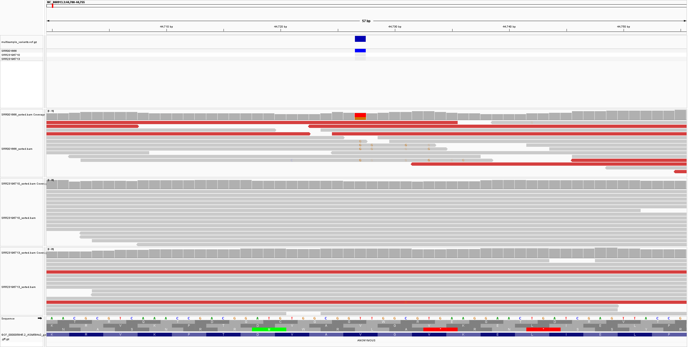
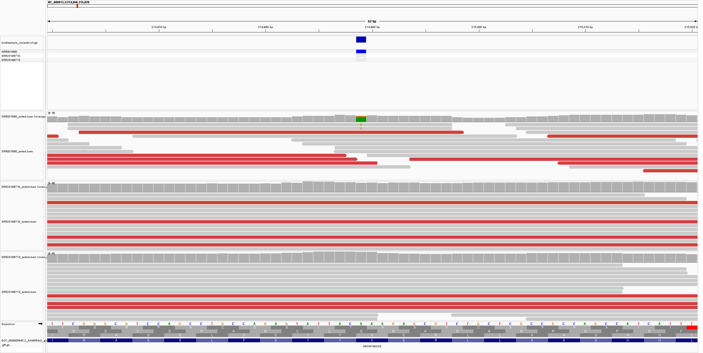

# Week 08: Predict Variant Effects

## Overview

In this assignment, I extended the previous variant-calling workflow to create a multisample VCF and predict the effects of selected variants that occur within protein-coding sequences.

Three *Escherichia coli* K-12 MG1655 sequencing samples were analyzed:

- `SRR001666`
- `SRR23196710`
- `SRR23196713`

All three samples were aligned to the same *E. coli* K-12 MG1655 reference genome:

- **Assembly:** `GCF_000005845.2`
- **Chromosome:** `NC_000913.3`

The Makefile automates read processing, alignment, BAM generation, multisample variant calling, VCF statistics, and coding-variant annotation.

---

## Workflow

```text
Three paired-end sequencing samples
              ↓
        fastp filtering
              ↓
      Bowtie2 alignment
              ↓
     Three sorted BAM files
              ↓
     Joint variant calling
       with bcftools
              ↓
       Multisample VCF
              ↓
       Coding variants
              ↓
 Gene + codon + amino-acid effect
```

---

## Samples

The three samples used in the multisample analysis were:

```text
SRR001666
SRR23196710
SRR23196713
```

Read-group sample identifiers were added during alignment so that the samples remained separate in the multisample VCF.

---

## Genome Coverage

The final BAM files had the following mean genome depths:

| Sample | Mean depth | Genome covered |
|---|---:|---:|
| SRR001666 | 10.36× | 99.9843% |
| SRR23196710 | 38.71× | 99.7971% |
| SRR23196713 | 36.64× | 99.7938% |

All three samples therefore had greater than 10× mean genome coverage.

---

## Multisample Variant Calling

The three BAM files were jointly analyzed using `bcftools mpileup` and `bcftools call`.

The resulting multisample VCF contained three sample columns:

```text
SRR001666
SRR23196710
SRR23196713
```

The final multisample VCF contained:

```text
Total variants: 261
SNPs:           220
Indels:          41
```

---

## Coding-Variant Annotation

The NCBI annotation corresponding to assembly `GCF_000005845.2` was used to identify variants located inside coding sequences.

A Python script then determined, for simple coding SNPs:

- the gene containing the variant,
- the strand,
- the affected codon,
- the reference codon,
- the alternate codon,
- the reference amino acid,
- the alternate amino acid,
- and the predicted consequence.

The coding-variant analysis identified:

```text
118 missense variants
42 synonymous variants
4 stop-gained variants
```

For the final report, I selected three isolated missense variants in different genes.

---

# Variant 1: fkpB

The first selected variant occurs at:

```text
NC_000913.3:25895
```

### Gene information

- **Gene:** `fkpB`
- **Locus tag:** `b0028`
- **Product:** peptidyl-prolyl cis-trans isomerase FkpB
- **Strand:** +
- **Codon number:** 24

### Variant effect

```text
Reference nucleotide: A
Alternate nucleotide: C

Reference codon: ACC
Alternate codon: CCC

Reference amino acid: Thr (T)
Alternate amino acid: Pro (P)

Effect: missense
```

Therefore, this nucleotide substitution changes codon `ACC`, which encodes threonine, to `CCC`, which encodes proline.

### Multisample support

The VCF and read-depth information were:

```text
SRR001666     GT=0/1   DP=10   AD=6,4
SRR23196710   GT=0/0   DP=21   AD=21,0
SRR23196713   GT=0/0   DP=14   AD=13,1
```

The alternate allele is mainly supported in `SRR001666`, while the other two samples predominantly support the reference allele.

The `0/1` genotype is reported exactly as generated by the variant caller. Because *E. coli* is normally haploid, the genotype should not be interpreted as ordinary diploid heterozygosity; the allele-depth values provide the more useful representation of read support in this analysis.

### IGV visualization

The variant was visualized together with all three BAM files, the multisample VCF, the reference sequence, translated sequence, and genome annotation.



The IGV view shows alternate C bases among reads from `SRR001666` at the called position, whereas the other two samples primarily support the reference sequence.

---

# Variant 2: fixC

The second selected variant occurs at:

```text
NC_000913.3:44727
```

### Gene information

- **Gene:** `fixC`
- **Locus tag:** `b0043`
- **Product:** putative oxidoreductase FixC
- **Strand:** +
- **Codon number:** 183

### Variant effect

```text
Reference nucleotide: T
Alternate nucleotide: G

Reference codon: GTT
Alternate codon: GGT

Reference amino acid: Val (V)
Alternate amino acid: Gly (G)

Effect: missense
```

This changes the encoded amino acid from valine to glycine.

### Multisample support

```text
SRR001666     GT=0/1   DP=7    AD=3,4
SRR23196710   GT=0/0   DP=18   AD=18,0
SRR23196713   GT=0/0   DP=13   AD=13,0
```

Four of seven reads in `SRR001666` support the alternate allele, while neither of the other samples shows alternate-read support at this position.

### IGV visualization

The IGV view shows alternate G bases in `SRR001666` at the called position, while `SRR23196710` and `SRR23196713` support the reference allele.



---

# Variant 3: arfB

The third selected variant occurs at:

```text
NC_000913.3:214989
```

### Gene information

- **Gene:** `arfB`
- **Locus tag:** `b0191`
- **Product:** peptidyl-tRNA hydrolase, ribosome rescue factor
- **Strand:** +
- **Codon number:** 53

### Variant effect

```text
Reference nucleotide: A
Alternate nucleotide: G

Reference codon: AAA
Alternate codon: GAA

Reference amino acid: Lys (K)
Alternate amino acid: Glu (E)

Effect: missense
```

This substitution changes the encoded amino acid from lysine to glutamate.

### Multisample support

```text
SRR001666     GT=0/1   DP=8    AD=6,2
SRR23196710   GT=0/0   DP=30   AD=30,0
SRR23196713   GT=0/0   DP=32   AD=32,0
```

The alternate allele is supported by two reads in `SRR001666`. Both additional samples exclusively support the reference allele at this position.

### IGV visualization

The IGV view shows limited alternate G support in `SRR001666`, consistent with the allele depth of 6 reference reads and 2 alternate reads. The other two samples support the reference allele.



---

## Selected Variant Summary

| Position | Gene | REF → ALT | Reference codon | Alternate codon | Amino-acid change | Effect |
|---|---|---|---|---|---|---|
| 25,895 | `fkpB` | A → C | ACC | CCC | Thr → Pro | Missense |
| 44,727 | `fixC` | T → G | GTT | GGT | Val → Gly | Missense |
| 214,989 | `arfB` | A → G | AAA | GAA | Lys → Glu | Missense |

---

## Software Output for the Selected Variants

The coding-effect annotation generated the following output:

```text
CHROM       POS     REF ALT gene locus_tag strand codon_number ref_codon alt_codon ref_aa alt_aa effect
NC_000913.3 25895   A   C   fkpB b0028     +      24           ACC       CCC       T      P      missense
NC_000913.3 44727   T   G   fixC b0043     +      183          GTT       GGT       V      G      missense
NC_000913.3 214989  A   G   arfB b0191     +      53           AAA       GAA       K      E      missense
```

The complete automatically generated output is stored in:

```text
annotation/coding_variant_effects.tsv
```

and the variants selected for this report are stored in:

```text
annotation/selected_variant_effects.tsv
```

---

## Reproducing the Analysis

From inside the `Week_08` directory, the complete analysis can be run with:

```bash
make
```

The workflow uses:

```text
N = 750000
```

for each sequencing run.

The Makefile performs the following major steps:

1. Downloads the reference genome and genome annotation.
2. Downloads paired-end reads for all three samples.
3. Filters reads with `fastp`.
4. Aligns each sample using Bowtie2.
5. Sorts and indexes each BAM using samtools.
6. Calculates BAM coverage statistics.
7. Jointly calls variants from the three BAM files with bcftools.
8. Creates and indexes the multisample VCF.
9. Generates VCF statistics.
10. Identifies coding variants and predicts codon and amino-acid changes.
11. Generates the selected variant-effect table used in this report.

---

## Conclusion

A multisample VCF was successfully generated from three *E. coli* K-12 MG1655 sequencing samples.

The analysis identified 261 variants, including 220 SNPs and 41 indels. Coding-effect analysis identified missense, synonymous, and stop-gained SNPs.

Three missense variants were examined in detail. The selected variants occur in `fkpB`, `fixC`, and `arfB` and change the encoded amino acids Thr→Pro, Val→Gly, and Lys→Glu, respectively.

The multisample VCF made it possible to compare each position across all three samples. For all three selected examples, the alternate allele was observed primarily in `SRR001666`, while `SRR23196710` and `SRR23196713` predominantly supported the reference sequence.