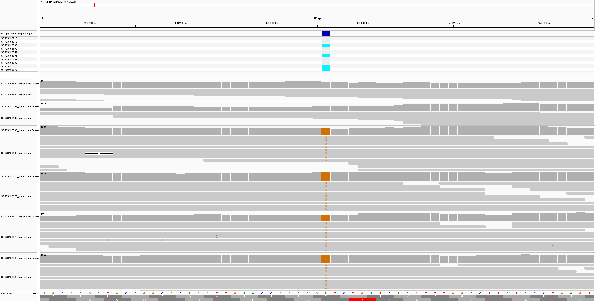

# Week_09: Reproducible Multi-Sample Variant Calling Workflow

## Overview

This assignment extends the previous variant-calling workflow so that multiple sequencing samples can be processed automatically using a design file.

I used whole-genome sequencing samples from BioProject `PRJNA926794`. This BioProject contains *Escherichia coli* K-12 MG1655 sequencing data associated with a study of evolutionary paths to high-level ampicillin resistance.

The available metadata contained 420 paired-end WGS runs from this BioProject. For this assignment, I selected 10 different BioSamples and recorded them in `design.csv`.

The workflow automatically:

1. Reads sample information from `design.csv`.
2. Downloads paired-end reads.
3. Filters reads with `fastp`.
4. Aligns reads to the *E. coli* K-12 MG1655 reference genome with Bowtie2.
5. Creates sorted and indexed BAM files with samtools.
6. Calls variants separately for each sample using bcftools.
7. Merges the individual VCF files into one multisample VCF.
8. Generates coverage and variant statistics.

---

## Design File

The workflow uses:

```text
design.csv
```

The design file contains 10 sequencing runs together with their BioSample, sample name, BioProject, average spot length, and number of SRA spots used for analysis.

The selected runs are:

```text
SRR23196710
SRR23196713
SRR23196536
SRR23196598
SRR23196542
SRR23196896
SRR23196889
SRR23196930
SRR23196675
SRR23196678
```

The number of spots downloaded for each run was calculated separately using the average spot length so that each sample would have approximately 15× theoretical input coverage.

---

## Reference Genome

All samples were aligned to the same reference genome:

```text
Organism: Escherichia coli K-12 MG1655
Assembly: GCF_000005845.2
Chromosome: NC_000913.3
```

---

## Running the Workflow

The required software is expected to already be available in the `bioinfo` environment. The Makefile does not install software automatically.

Required tools include:

```text
fastq-dump
fastp
bowtie2
samtools
bcftools
curl
```

First check the design file and available software:

```bash
make check-design
make check-tools
```

A dry run can be performed with:

```bash
make -n batch
```

The complete workflow can then be run with:

```bash
make -j 4 batch
```

The `-j 4` option allows several independent sample-processing steps to run in parallel.

---

## Coverage Results

All 10 samples produced high genome coverage.

Mean sequencing depth ranged from approximately:

```text
13.33× to 14.48×
```

Genome coverage was approximately:

```text
99.75% to 99.79%
```

Therefore, all samples had sufficient coverage for variant analysis.

---

## Multisample Variant Results

After calling variants separately for each sample, the individual VCF files were merged into:

```text
variants/merged_multisample.vcf.gz
```

The merged VCF contained all 10 samples and a total of:

```text
Total variants: 205
SNPs:           172
Indels:          33
```

---

## Example Multisample Difference

An informative SNP was observed at:

```text
NC_000913.3:458306
```

The variant is:

```text
Reference allele: A
Alternate allele: G
```

The alternate allele was detected in four samples:

```text
SRR23196536
SRR23196896
SRR23196675
SRR23196678
```

Read support for the alternate allele was:

```text
SRR23196536   DP=12   AD=0,12
SRR23196896   DP=11   AD=0,11
SRR23196675   DP=10   AD=0,10
SRR23196678   DP=6    AD=0,6
```

These samples therefore showed strong read support for the G allele.

The remaining samples were reference-like at this position.

Interestingly, the same four samples also carried alternate alleles at additional positions, including `93019` and `1619468`, showing a consistent pattern of sequence differences among samples in the project.

---

## IGV Visualization

The merged VCF and representative BAM alignments were visualized in IGV around position `458306`.

The vertical column of G bases in the BAM alignments shows the alternate allele in the four variant-containing samples, while reference-like samples do not show the same mismatch.



---

## Reproducibility

The main purpose of this workflow is reproducibility.

Sample-specific metadata are stored in `design.csv`, while the Makefile reads that file automatically rather than requiring run accessions to be entered manually.

A reviewer with the required bioinformatics tools can reproduce the analysis by running:

```bash
make -j 4 batch
```

This command processes the samples listed in `design.csv` and generates the BAM files, individual VCF files, merged multisample VCF, and summary statistics.
