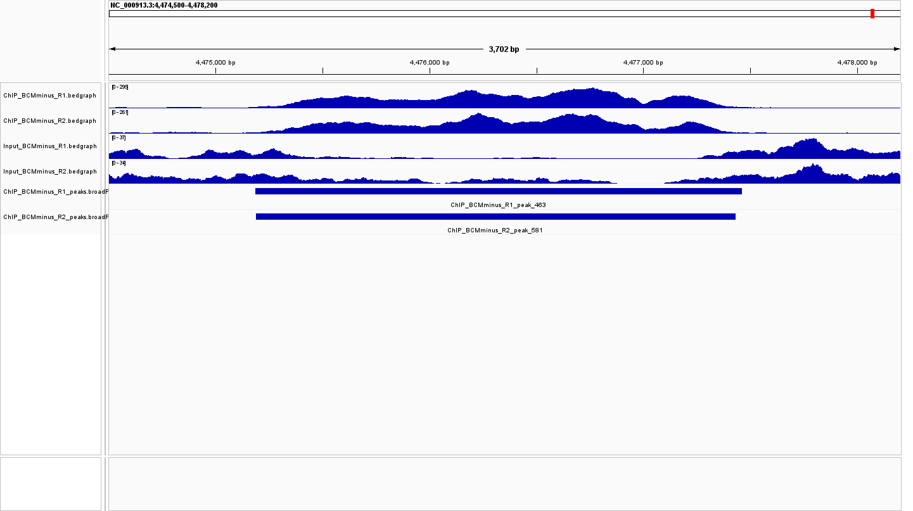
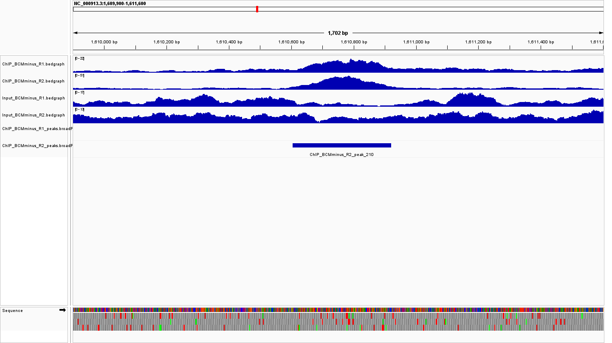

# Week 10: ChIP-seq Peak Calling Workflow

## Overview

For this assignment, I adapted my previous multi-sample workflow to analyze ChIP-seq data and call enriched genomic regions.

The dataset is from *Escherichia coli* K-12 MG1655 BioProject `PRJNA224578`. The experiment examines H-NS binding with and without bicyclomycin (BCM).

I used eight single-end sequencing samples:

* 2 H-NS ChIP replicates without BCM
* 2 H-NS ChIP replicates with BCM
* 2 matching Input controls without BCM
* 2 matching Input controls with BCM

All samples contain 51-bp single-end reads.

Sample metadata and the relationships between ChIP and Input samples are stored in `design.csv`.

---

## Workflow

The Makefile automatically performs the following steps:

1. Reads sample information from `design.csv`.
2. Downloads SRA reads.
3. Filters reads using `fastp`.
4. Aligns reads to the *E. coli* K-12 MG1655 reference genome using Bowtie2.
5. Creates sorted and indexed BAM files using samtools.
6. Generates normalized bedGraph coverage tracks.
7. Calls broad ChIP-seq peaks with MACS3 using the matching Input sample as control.
8. Compares biological replicate peak calls using bedtools.

The reference genome used was:

```text
GCF_000005845.2_ASM584v2
NC_000913.3
```

---

## Running the Workflow

The required programs must already be available in the `bioinfo` environment.

The major tools used are:

```text
fastq-dump
fastp
bowtie2
samtools
bedtools
macs3
curl
```

Check the design file and required tools with:

```bash
make check-design
make check-tools
```

Run a dry test with:

```bash
make -n batch
```

Run the complete workflow with:

```bash
make -j 4 batch
```

---

## Peak Calling Results

MACS3 produced the following number of broad peaks:

| Sample           | Peaks |
| ---------------- | ----: |
| ChIP_BCMminus_R1 |   488 |
| ChIP_BCMminus_R2 |   610 |
| ChIP_BCMplus_R1  |   679 |
| ChIP_BCMplus_R2  |   651 |

---

## Replicate Consistency

### BCM− replicates

The BCM− replicates showed strong agreement.

```text
Jaccard similarity: 0.877631
Shared R1 peaks: 485
R1-specific peaks: 3
R2-specific peaks: 111
```

Of the 488 peaks detected in replicate 1, 485 overlapped a peak in replicate 2.

### BCM+ replicates

The BCM+ replicates also showed substantial agreement, although the similarity was lower than for the BCM− samples.

```text
Jaccard similarity: 0.764094
Shared R1 peaks: 558
R1-specific peaks: 121
R2-specific peaks: 55
```

Overall, the BCM− biological replicates were more consistent than the BCM+ replicates based on the Jaccard comparison.

---

## Region Where Replicates Agree

A clear example of agreement between the BCM− replicates occurs around:

```text
NC_000913.3:4,474,500-4,478,200
```

Both ChIP replicates show strong enrichment in the coverage tracks, and MACS3 called overlapping broad peaks in both replicates.

This indicates that this enriched region was reproducibly detected in both biological replicates.



---

## Region Where Replicates Disagree

An example of disagreement occurs around:

```text
NC_000913.3:1,609,900-1,611,600
```

Both ChIP coverage tracks show some enrichment in this region. However, MACS3 called a broad peak only in `ChIP_BCMminus_R2` (`ChIP_BCMminus_R2_peak_210`) and not in `ChIP_BCMminus_R1`.

Therefore, the disagreement is in the formal peak calls rather than a complete absence of signal in replicate 1. The difference likely reflects the relative strength of enrichment compared with each replicate's Input control and the MACS3 peak-calling threshold.



---

## Summary

The automated workflow successfully processed ChIP-seq and Input samples, generated normalized coverage tracks, called peaks with MACS3, and compared biological replicates.

The BCM− replicates were highly consistent, with a Jaccard similarity of approximately 0.88. The BCM+ replicates were somewhat less consistent, with a Jaccard similarity of approximately 0.76.

IGV visualization also showed that replicate agreement can be evaluated using both the underlying coverage signal and the final MACS3 peak calls.
