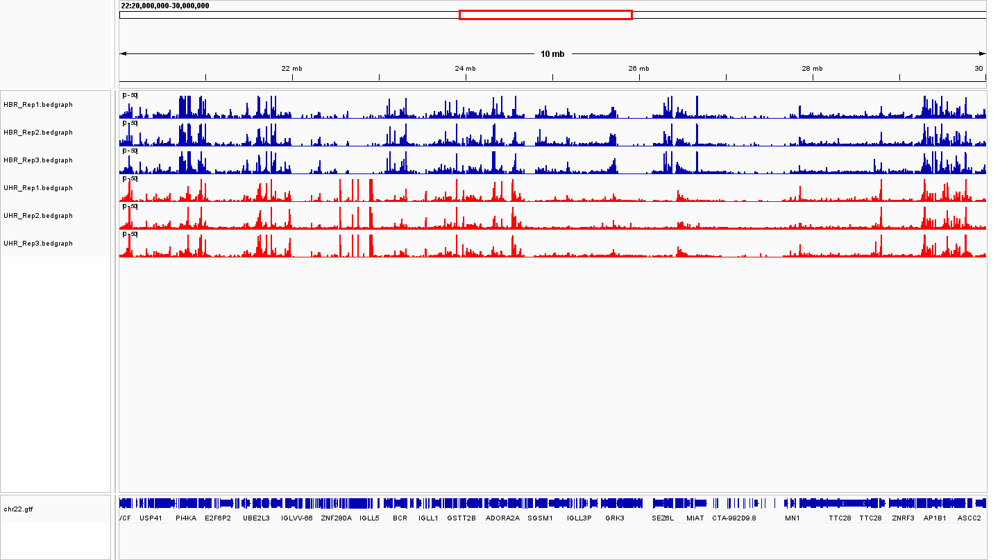
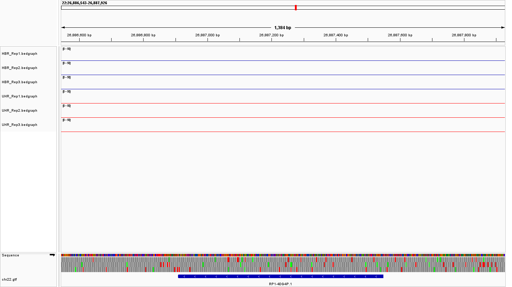
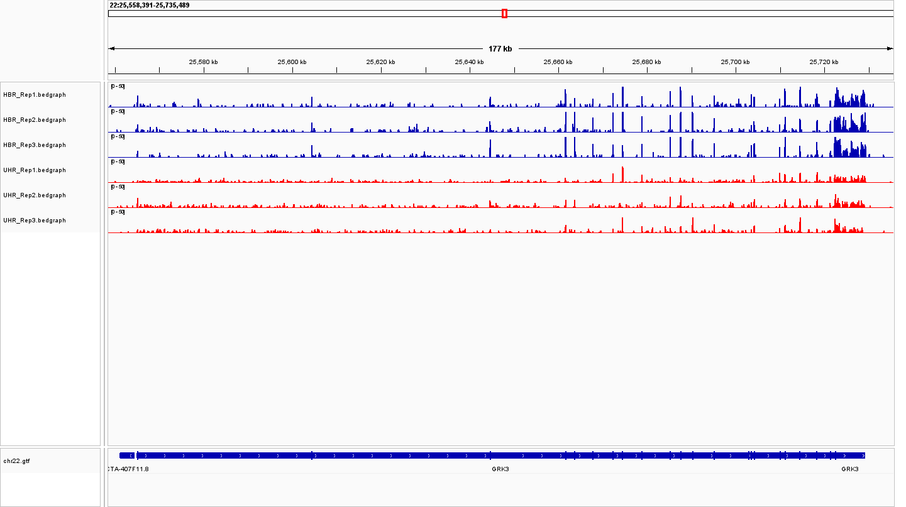
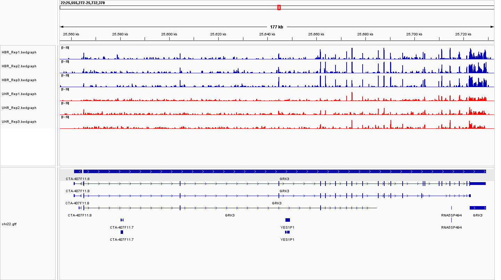
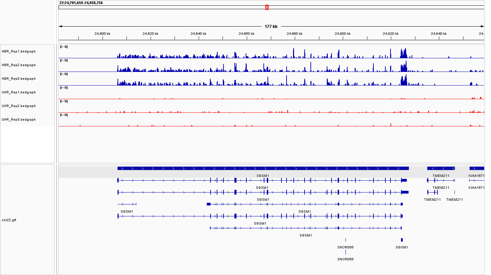

# Week_11: Evaluate Gene Expression Coverage

## Overview

In this assignment, I used IGV to visually compare RNA-seq coverage between two human reference RNA sample types on chromosome 22.

* **HBR (Human Brain Reference):** RNA isolated from human brain tissue
* **UHR (Universal Human Reference):** RNA from a mixture of 10 cancer cell lines

Three biological replicates were analyzed for each sample type.

The chromosome 22 reference genome and GTF annotation were loaded into IGV together with normalized RNA-seq coverage tracks for all six samples.

The samples were:

| Sample type | Replicates                   |
| ----------- | ---------------------------- |
| HBR         | HBR_Rep1, HBR_Rep2, HBR_Rep3 |
| UHR         | UHR_Rep1, UHR_Rep2, UHR_Rep3 |

The RNA-seq reads were aligned to the chromosome 22 reference using HISAT2. All six samples had approximately **99.95–99.96% overall alignment rates**. Coverage tracks were generated as normalized bedGraph files and visualized in IGV.

---

## 1. How are the two sample types different?

I first examined a wide region of chromosome 22:

```text
22:20,000,000-30,000,000
```

The HBR and UHR samples showed clearly different RNA-seq coverage patterns. Many genomic regions were expressed in both sample types, but the relative coverage differed substantially at several locations. Some regions showed stronger expression in HBR, while others showed stronger expression in UHR.

This indicates substantial sample-specific gene expression differences between human brain RNA and the universal reference RNA mixture.



---

## 2. How consistent are the replicates?

The three replicates within each sample type were highly consistent overall.

The three HBR tracks showed peaks at approximately the same genomic positions and generally similar coverage profiles. Likewise, the three UHR replicates showed very similar expression patterns.

Although the exact coverage heights varied among replicates, the overall positions and shapes of expressed regions were reproducible.

---

## 3. Find a gene that is not expressed in any of the samples

I identified **RP1-40G4P.1** as an example of a gene with no detectable expression.

Across the annotated gene region, all three HBR and all three UHR coverage tracks remained at baseline, indicating that the gene was not detectably expressed in either sample type.



---

## 4. Find a gene that is very strongly expressed in all samples. What is its coverage?

I selected **GRK3** as a strongly expressed gene.

The gene spans approximately:

```text
22:25,564,849-25,729,294
```

Maximum normalized coverage within the GRK3 region was:

| Sample   | Maximum normalized coverage |
| -------- | --------------------------: |
| HBR_Rep1 |                       71.72 |
| HBR_Rep2 |                       79.44 |
| HBR_Rep3 |                       96.36 |
| UHR_Rep1 |                       55.00 |
| UHR_Rep2 |                       33.89 |
| UHR_Rep3 |                       40.47 |

GRK3 was therefore clearly expressed in all six samples, although coverage was generally higher in HBR.



---

## 5. Can you identify the transcripts that are expressed?

Three GRK3 transcripts were present in the annotation:

```text
GRK3-001
GRK3-002
GRK3-201
```

The RNA-seq coverage clearly supports expression of GRK3 and extends across exons included in the longer transcript models.

However, GRK3-001 and GRK3-002 share many exons, making it difficult to distinguish them using coverage alone. The shorter transcript by itself cannot explain all of the observed coverage.

Therefore, at least one of the longer GRK3 transcripts is expressed, but these coverage tracks alone are insufficient to determine whether GRK3-001, GRK3-002, or both are expressed.



---

## 6. Find a gene where expression is clearly different between HBR and UHR. What is the fold change?

I selected **SGSM1**, which showed a strong difference between the two sample types.

SGSM1 spans:

```text
22:24,806,169-24,927,578
```

Mean normalized exon coverage was:

| Sample   | Mean normalized coverage |
| -------- | -----------------------: |
| HBR_Rep1 |                  17.5275 |
| HBR_Rep2 |                  18.8969 |
| HBR_Rep3 |                  17.2320 |
| UHR_Rep1 |                   2.6336 |
| UHR_Rep2 |                   4.0571 |
| UHR_Rep3 |                   4.3248 |

The average normalized coverage was approximately:

```text
HBR mean = 17.89
UHR mean = 3.67
```

Therefore:

```text
Fold change = 17.89 / 3.67 ≈ 4.87
```

SGSM1 expression was approximately **4.87-fold higher in HBR than in UHR**.



---

## 7. Is the transcript upregulated or downregulated?

SGSM1 is **upregulated in HBR relative to UHR**.

All three HBR replicates showed substantially higher RNA-seq coverage across SGSM1 than the three UHR replicates.

---

## 8. How certain are you that this is not a random fluctuation? Why?

I am reasonably confident that the difference is not simply a random fluctuation because the same pattern was observed consistently across all three biological replicates.

All three HBR samples showed substantially higher SGSM1 coverage than all three UHR samples, and the within-group coverage values were relatively consistent. The approximately **4.9-fold difference** was therefore reproducible across the replicates.

However, this conclusion is based on normalized coverage and visual inspection rather than a formal statistical differential-expression test.

---

## Summary

RNA-seq visualization in IGV revealed clear expression differences between the HBR and UHR samples while showing strong consistency among biological replicates.

`RP1-40G4P.1` provided an example of a gene with no detectable expression, while `GRK3` was strongly expressed in all six samples. GRK3 also demonstrated the difficulty of determining individual transcript isoforms when multiple transcripts share many exons.

`SGSM1` showed one of the clearest sample-specific differences, with approximately **4.87-fold higher expression in HBR than UHR**. The consistency of this difference across all three replicates supports the conclusion that the observed expression difference is biologically reproducible rather than simply random variation.
